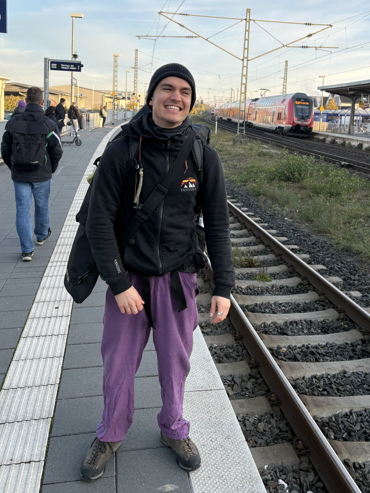
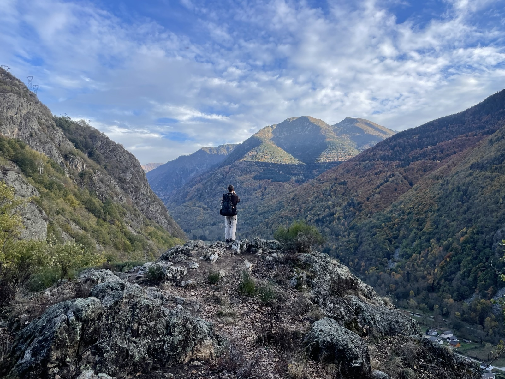

On Monday the 02.11.2026 I leave Germany for the last time this year. 

*Vollbepackt zur Abfahrt von der Bergstraße. Geschossen von einer Mitwartenden am Bahnhof.*

In the coming week I stay with Josi, a close friend from choire in Heidelberg. We sleep lots, eat great fromage (Époisses is my new favorite), talk lots, sing songs and watch good movies. One day we spend on a hike in the Pyrenees.

*View of Pic de Péréjat (2276m). If anyone has an understanding of the horizontal lines of differently colored trees seen on _Péjérat_, please enlighten us.*

Perhaps most importantly we stumbled upon Laris (proncounced la.ʁi, as derived from *lapin* and *souris*). We found them on one of the many bike vélô Toulouse rides sitting all abandoned by a flower pot. Seeing how Laris was all wet and cold, we promptly gave them a hot bath.

*Laris bathing at Josi's place.*